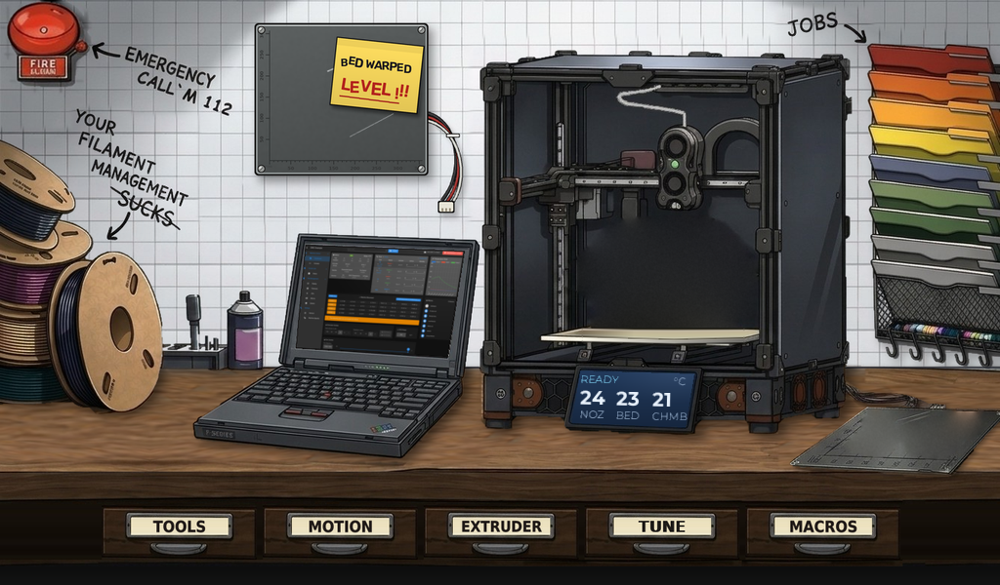
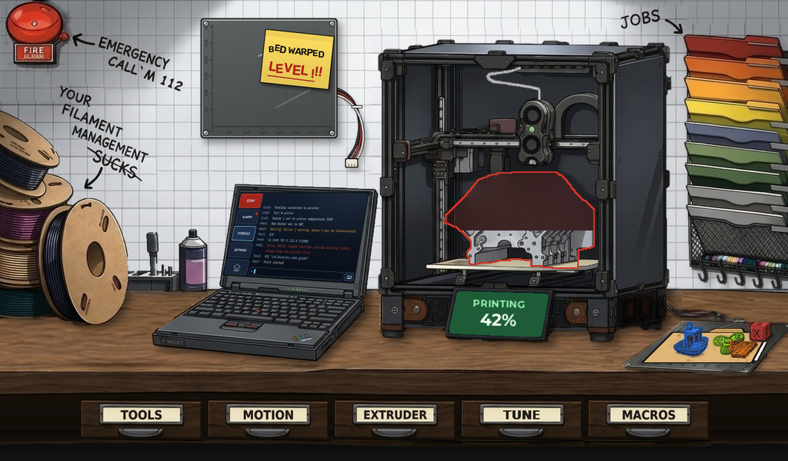

# DuetScreen7 Funky UI

An illustrated home screen for the DuetScreen 7, built on top of
[Duet3D/DuetScreen](https://github.com/Duet3D/DuetScreen). The home screen is a
workshop scene: printer on a workbench, spools, job rack, laptop and five drawers.
Everything else (connection to the board, object model, control pages, files,
console, settings) is DuetScreen's.





## What is ours

| Path | What |
|---|---|
| `src/UI/Widgets/Workshop/` | The workshop scene (view, presenter, positions) |
| `assets/workshop/` | Runtime images, 1024 × 600 |
| `art/` | Source art and masters, see `art/README.md` |
| `docs/workshop/` | Screenshots and the clickable browser mock-up |
| `tests/src/test_cases/UI/test_workshop.cpp` | Screenshot tests of the scene (references in `tests/ref_imgs/workshop/`) |
| `.github/workflows/funky-ci.yml` | Builds, runs the tests, publishes logs and screenshots to the `ci-results` branch |
| `.github/workflows/upstream-sync.yml` | Weekly check for upstream changes, opens a PR |
| small hooks | `HomeView` (registers the scene), `Storage` (`ui:workshop_home` setting) |

Keep changes to upstream files small, so upstream updates merge cleanly.

## Popups

One popup style for the whole UI; see [docs/workshop/POPUPS.md](docs/workshop/POPUPS.md) (locked).

## Tap zones


| Zone | Opens now | Planned |
|---|---|---|
| Fire alarm | emergency stop (`M112`) | |
| TOOLS | Control › Temperature | own drawer page |
| MOTION | Control › Move | own drawer page |
| EXTRUDER | Control › Temperature (extruder controls) | own drawer page |
| TUNE | Dashboard › Status (fine tune) | own drawer page |
| MACROS | Files › Macros | own drawer page |
| Spool pile | Control › Temperature (filament) | filament management |
| Wall bed with the "LEVEL !!!" note | Control › Height map | bed levelling |
| Laptop | Console | console / alarm / settings |
| Printer | Dashboard › Status | print status |
| Job folder rack | Files › Jobs | jobs |
| Spare bed on the table | Control › Object cancel | cancel object |

Opening anything hides the scene and shows DuetScreen's normal layout; the
side bar's **Home** button returns to the workshop.

## Printer state on the scene

| State | Printer bed | Spare bed | Printer's display |
|---|---|---|---|
| Idle | empty | empty | READY + nozzle / bed / chamber °C |
| Printing | print grows upward with progress | random 1–4 finished parts | %, nozzle °C, time left, bar |
| Paused | print stays | parts stay | PAUSED |
| Disconnected | empty | empty | OFFLINE |

## Classic home screen

Setting `ui:workshop_home` (default `true`). Set it to `false` to get DuetScreen's
original dashboard as the home screen. The unit tests use the classic home so
upstream reference screenshots stay valid; `test_workshop.cpp` turns the scene on.

## Building

Same as upstream DuetScreen, see [docs/DEVELOPMENT.md](docs/DEVELOPMENT.md)
(Ubuntu 24.04 or WSL2, `gcc-15`):

```bash
git clone --recursive https://github.com/M0ti0n/DuetScreen7_FUNKY_UI_3DP.git
cd DuetScreen7_FUNKY_UI_3DP
./scripts/install_prerequisites.sh
cmake --preset Simulation-Release
cmake --build --preset Simulation-Release
./out/build/Simulation-Release/DuetScreen
```

## Upstream updates

`upstream` = Duet3D/DuetScreen, branch `dev`.

```bash
git remote add upstream https://github.com/Duet3D/DuetScreen.git   # once
git fetch upstream
git merge upstream/dev
```

The **Upstream sync** workflow checks every Monday and opens a pull request when
upstream has new commits. Merge it with a merge commit, not a squash.

The first standalone prototype is kept on the `standalone` branch.
