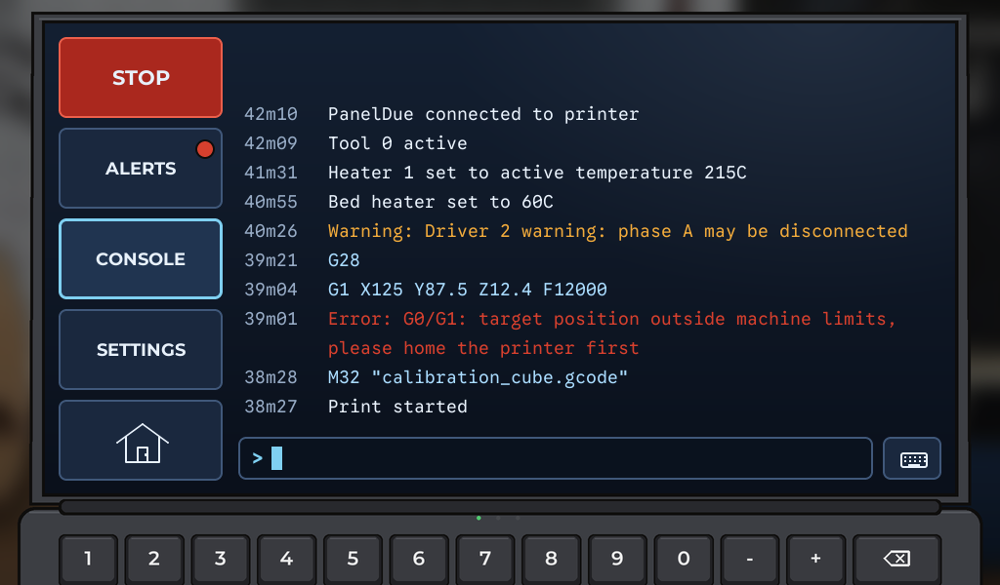
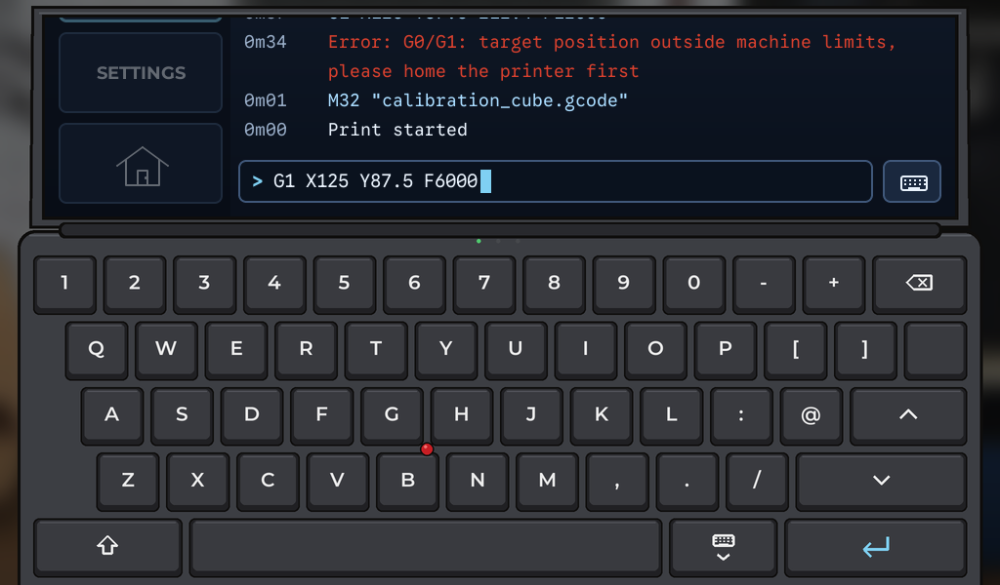
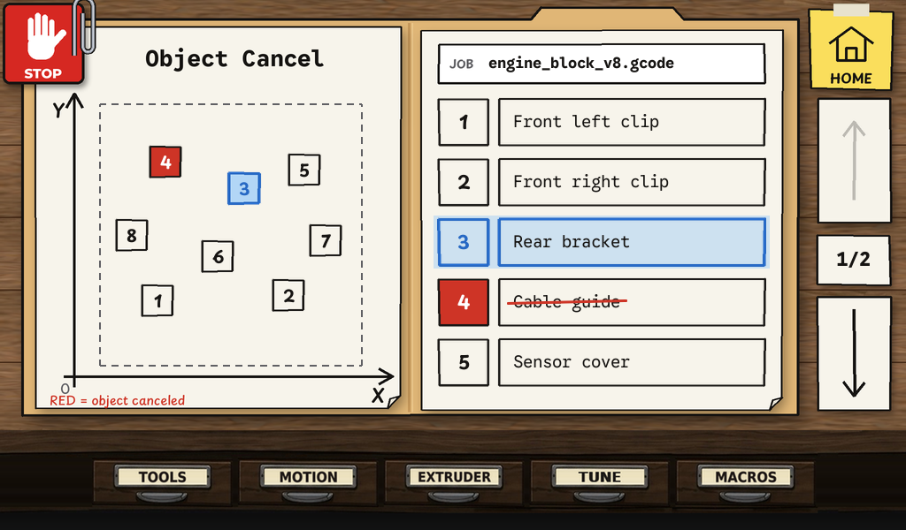
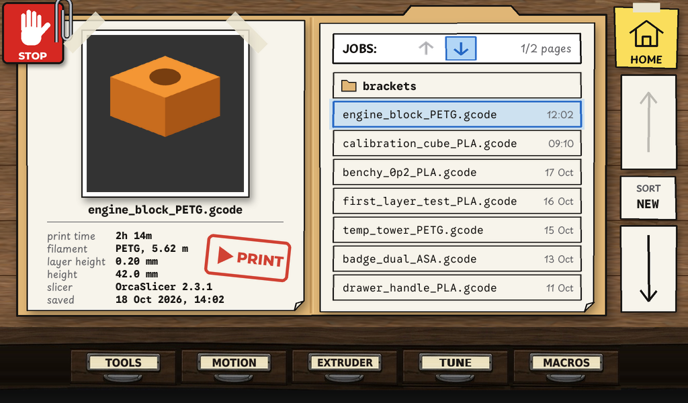

# DuetScreen7 Funky UI

An illustrated home screen for the DuetScreen 7, built on top of
[Duet3D/DuetScreen](https://github.com/Duet3D/DuetScreen). The home screen is a
workshop scene: printer on a workbench, spools, job rack, laptop and five drawers.
Everything else (connection to the board, object model, control pages, files,
console, settings) is DuetScreen's.


## What is ours

| Path | What |
|---|---|
| `src/UI/Widgets/Workshop/` | The workshop scene (view, presenter, positions) |
| `src/UI/Widgets/Laptop/` | The laptop page (console, alerts, settings, keyboard) and the shared popup |
| `src/UI/Widgets/ObjectFolder/` | The object cancel folder |
| `src/UI/Widgets/JobsFolder/` | The jobs folder (list model in `JobsList`) |
| `assets/workshop/` | Runtime images, 1024 × 600 |
| `art/` | Source art and masters, see `art/README.md` |
| `docs/workshop/` | Screenshots (`laptop/` for the laptop page) and the clickable browser mock-up |
| `tests/src/test_cases/UI/test_workshop.cpp` | Screenshot tests of the scene (references in `tests/ref_imgs/workshop/`) |
| `tests/src/test_cases/UI/test_laptop.cpp` | Laptop page tests (references in `tests/ref_imgs/laptop/`) |
| `tests/src/test_cases/UI/test_object_folder.cpp`, `test_jobs_folder.cpp` | Folder tests (references in `tests/ref_imgs/objects/`, `jobs/`) |
| `.github/workflows/funky-ci.yml` | Builds, runs the tests, publishes logs and screenshots to the `ci-results` branch |
| `.github/workflows/upstream-sync.yml` | Weekly check for upstream changes, opens a PR |
| small hooks | `HomeView` (registers the scene and the laptop), `Storage` (`ui:workshop_home` setting), `main.cpp` (touch click / M300 sound) |

Keep changes to upstream files small, so upstream updates merge cleanly.

## Popups

One popup style for the whole UI; see [docs/workshop/POPUPS.md](docs/workshop/POPUPS.md) (locked).

## Tap zones


| Zone | Opens now | Planned |
|---|---|---|
| Fire alarm | emergency stop (`M112`) | |
| TOOLS | Control › Temperature | own drawer page |
| MOTION | Control › Move | own drawer page |
| EXTRUDER | Control › Temperature (extruder controls) | own drawer page |
| TUNE | Dashboard › Status (fine tune) | own drawer page |
| MACROS | Files › Macros | own drawer page |
| Spool pile | Control › Temperature (filament) | filament management |
| Wall bed with the "LEVEL !!!" note | Control › Height map | bed levelling |
| Laptop | Laptop page: CONSOLE / ALERTS / SETTINGS | |
| Printer | Dashboard › Status | print status |
| Job folder rack | Jobs folder | |
| Spare bed on the table | Object cancel folder | |

Opening anything hides the scene and shows DuetScreen's normal layout; the
side bar's **Home** button returns to the workshop.

## Printer state on the scene

| State | Printer bed | Spare bed | Printer's display |
|---|---|---|---|
| Idle | empty | empty | READY + nozzle / bed / chamber °C |
| Printing | print grows upward with progress | random 1–4 finished parts | %, nozzle °C, time left, bar |
| Paused | print stays | parts stay | PAUSED |
| Disconnected | empty | empty | OFFLINE |

## Classic home screen

Setting `ui:workshop_home` (default `true`). Set it to `false` to get DuetScreen's
original dashboard as the home screen. The unit tests use the classic home so
upstream reference screenshots stay valid; `test_workshop.cpp` turns the scene on.

## Building

Same as upstream DuetScreen, see [docs/DEVELOPMENT.md](docs/DEVELOPMENT.md)
(Ubuntu 24.04 or WSL2, `gcc-15`):

```bash
git clone --recursive https://github.com/M0ti0n/DuetScreen7_FUNKY_UI_3DP.git
cd DuetScreen7_FUNKY_UI_3DP
./scripts/install_prerequisites.sh
cmake --preset Simulation-Release
cmake --build --preset Simulation-Release
./out/build/Simulation-Release/DuetScreen
```

## Upstream updates

`upstream` = Duet3D/DuetScreen, branch `dev`.

```bash
git remote add upstream https://github.com/Duet3D/DuetScreen.git   # once
git fetch upstream
git merge upstream/dev
```

The **Upstream sync** workflow checks every Monday and opens a pull request when
upstream has new commits. Merge it with a merge commit, not a squash.

The first standalone prototype is kept on the `standalone` branch.

## Laptop page





Side column, top to bottom: **STOP** (emergency stop, `M112`), **ALERTS** (red dot while
something is unread), **CONSOLE**, **SETTINGS**, **HOME** (back to the workshop).

| Page | What |
|---|---|
| CONSOLE | Every reply and typed command, with its age (`4m08`), newest at the bottom. Warnings amber, errors red, typed G-code blue. The command line or the keyboard button opens the keyboard. |
| Keyboard | The screen slides down, only its bottom part stays (the side column is pushed off and does nothing). Keys as Modern UI plus a cursor: SHIFT (lower case and symbols), L-shaped ENTER sends and stays open, arrow keys bottom right: ↑ / ↓ last 5 commands, ← / → move the cursor inside the line (typing inserts there, ⌫ erases before it), hide key closes (the unsent text stays). |
| ALERTS | 21 slots (3 pages of 7), newest first: `Error:` / `Warning:` lines and INFO events (connection, job start / pause / end). The oldest falls out. Right column: ▲, filter ALL → ERR → WRN → INFO (pages count only what matches), ▼. A tap opens the whole text; the row is then read. |
| SETTINGS 1/2 SYSTEM | BRIGHTNESS, SOUND, SCREEN DIMMING, ORIENTATION, CONNECTION (locked during a print; NETWORK asks for the IP on the keyboard), ABOUT, FACTORY RESET (asks first). Popups as in the DuetScreen7 CNC UI. |
| SETTINGS 2/2 PERSONALIZATION | DRAWER INDICATOR (stored; used once the drawer pages exist). Room for more. |

ORIENTATION offers NORMAL / UPSIDE DOWN: DuetScreen's display driver can only rotate the
picture (LVGL rotation), it can't mirror it.

LVGL's heap (`LV_MEM_SIZE` in `lv_conf.h`) is raised from 20 to 32 MB for the scene art. The
laptop keeps its art (as RGB888) only while it is shown; the popup frame only while a popup
is open.

## Object cancel folder



Opened from the spare bed. An open folder on the desk, working as the Modern UI OBJECT tab:

- **Left page:** the bed between pencil axes (its outline follows the printer's X / Y limits),
  a numbered box for each object at its centre. Blue = selected, red = cancelled. Boxes close
  together are moved apart.
- **Right page:** the job name and the objects, 5 per page. A name or a box on the bed selects
  (the list turns to its page); a number asks with the CANCEL OBJECT popup, ✓ sends `M486 P<n>`.
  Cancelled objects: red number, name struck through in red pen.
- The selection follows the object being printed; a tap keeps its choice until the next object starts.
- Page cards ▲ / page / ▼ on the right, the HOME sticky note above them, the STOP sticker
  (emergency stop) clipped in the corner, and the workbench drawers along the bottom: a drawer
  goes back to the workshop and slides open there.

Popups on this folder use the paper theme (see below).

Art: `art/objects/` (`export_objects.py` writes `assets/workshop/objects/`).

## Jobs folder



Opened from the job folder rack. Laid out like the object cancel folder:

- **Left page:** the selected job. Its thumbnail (largest one in the file, up to 250 × 250) as a
  photo taped onto the page, the file name, print time, filament (material and length), layer
  height, height, slicer and when it was saved. The red **PRINT** stamp is a button: the
  START PRINT popup has bin / X / ✓; the bin asks again (DELETE FILE) before deleting.
- **Right page:** `JOBS:` with the sort direction arrows ↑ ↓ and `page/pages`, then the files,
  8 a page, with their age. Folders come first; tap one to open it, `..` goes back up.
- **SORT card** (between ▲ and ▼) cycles **NEW** (newest on top), **A-Z** and **FILA**
  (by material, then name; the rows show a material tag instead of the age). The material is
  the last `_` part of the file name, as the slicer's output name template writes it, e.g.
  OrcaSlicer `{input_filename_base}_{filament_type[initial_tool]}.gcode`. Sort and direction
  are remembered.
- HOME, STOP and the drawers work as on the object cancel folder.

Art: `art/jobs/` (`export_jobs.py` writes `assets/workshop/jobs/`).

### Paper popups

The object cancel and jobs folders use a paper theme of the popup (`Funky::PopupTheme::Paper`):
the same frame, with cardboard instead of glass, paper tiles with ink outlines, and the coloured
buttons with ink icons and a thin ink outline. Everything else keeps the standard glass popup.
