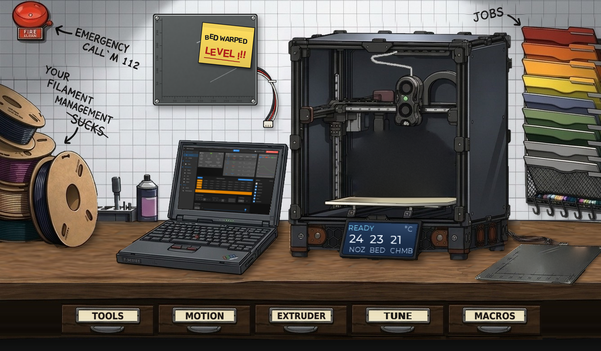
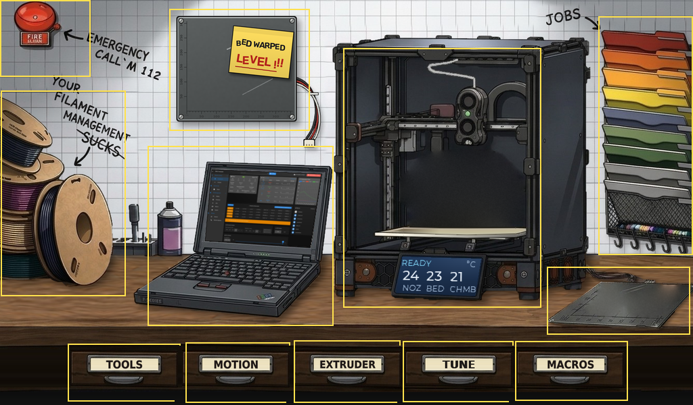

# DuetScreen7 Funky UI for 3D printers

An illustrated touchscreen UI for 3D printers running RepRapFirmware, built for the
**DuetScreen 7** (Allwinner T113-S3, 1024 × 600 capacitive). The home screen is a
workshop scene: printer on a workbench, spools, job rack, laptop, and drawers that
open the control pages.



It is a native [LVGL 9.2](https://lvgl.io) app written in C. The same code runs as:

| Target | `FUNKY_PLATFORM` | Use |
|---|---|---|
| Desktop simulator | `sdl` | develop on a PC (Linux, or Windows via WSL2) |
| DuetScreen 7 | `linux` | Linux framebuffer + evdev touch on the panel |
| Headless | `headless` | no window; writes screenshots (CI, previews) |

## Status

- [x] Home screen, idle: scene, 5 drawers with slide-out animation, all tap zones
- [x] Printing state: print grows on the printer's bed with progress, random finished
      parts on the spare bed, progress / temperatures on the printer's display
- [x] Fire alarm → confirm → `M112`
- [ ] USB link to the board and the RepRapFirmware object model (fake data for now)
- [ ] Drawer and object pages (placeholders for now)
- [ ] Slicer thumbnail → stylised print on the bed

## Build and run the simulator

Needs CMake, a C compiler and SDL2. On Ubuntu / WSL2:

```sh
sudo apt install build-essential cmake ninja-build libsdl2-dev
git clone --recurse-submodules https://github.com/M0ti0n/DuetScreen7_FUNKY_UI_3DP
cd DuetScreen7_FUNKY_UI_3DP
cmake -S . -B build -G Ninja -DFUNKY_PLATFORM=sdl
cmake --build build
./build/funky_ui            # idle
./build/funky_ui --demo     # loops idle -> printing 0-100 % -> idle
./build/funky_ui --zones    # outlines every tap zone
```

On Windows 11, WSL2 shows the SDL window directly (WSLg).

## Screenshots without a display

```sh
cmake -S . -B build-headless -G Ninja -DFUNKY_PLATFORM=headless
cmake --build build-headless
./build-headless/funky_ui --shot idle.ppm
./build-headless/funky_ui --shot printing.ppm --printing 42
./build-headless/funky_ui --shot drawer.ppm --drawer 3 --ms 900
./build-headless/funky_ui --shot estop.ppm --estop
```

CI builds every push and uploads these screenshots as an artifact.

## On the DuetScreen

```sh
cmake -S . -B build-ds -G Ninja -DFUNKY_PLATFORM=linux \
      -DCMAKE_TOOLCHAIN_FILE=<armhf toolchain>      # cross-compile, toolchain TBD
FUNKY_ASSETS=/opt/funky/assets FUNKY_FB=/dev/fb0 FUNKY_TOUCH=/dev/input/event0 ./funky_ui
```

Packaging into the DuetScreen image comes later.

## Repository layout

```
src/
  main.c                 start-up
  platform/              sdl / linux / headless display + input
  model/printer.[ch]     printer state the UI reads (fake source for now)
  ui/home.c              home scene, drawers, state layers, printer display
  ui/drawer_page.c       page that slides up when a drawer opens (placeholder)
  ui/estop.c             fire alarm -> M112 confirm
  ui/scene_layout.h      every position and tap zone on the scene
config/lv_conf.h         LVGL configuration
assets/                  runtime images at 1024 x 600 (loaded from disk)
art/                     source art and masters (see art/README.md)
docs/mockup.html         clickable browser mock-up of the home screen
docs/screens/            screenshots rendered by the headless build
lib/lvgl/                LVGL v9.2.2 (git submodule)
```

## Tap zones on the home screen



| Zone | Opens |
|---|---|
| Fire alarm | emergency stop (`M112`) |
| TOOLS · MOTION · EXTRUDER · TUNE · MACROS | drawer pages |
| Spool pile | filament management |
| Wall bed with the "LEVEL !!!" note | bed levelling |
| Laptop | console / alarm / settings |
| Printer | print status |
| Job folder rack | jobs |
| Spare bed on the table | cancel object |

Page names for the scene objects are provisional.
