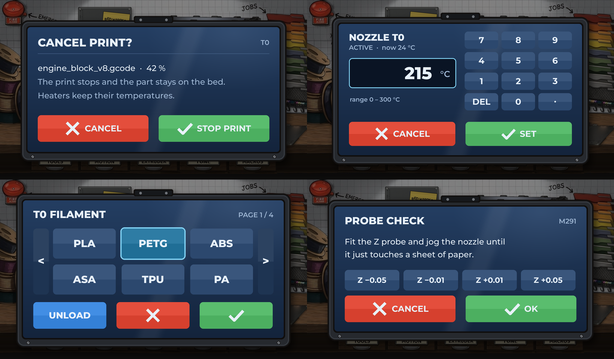
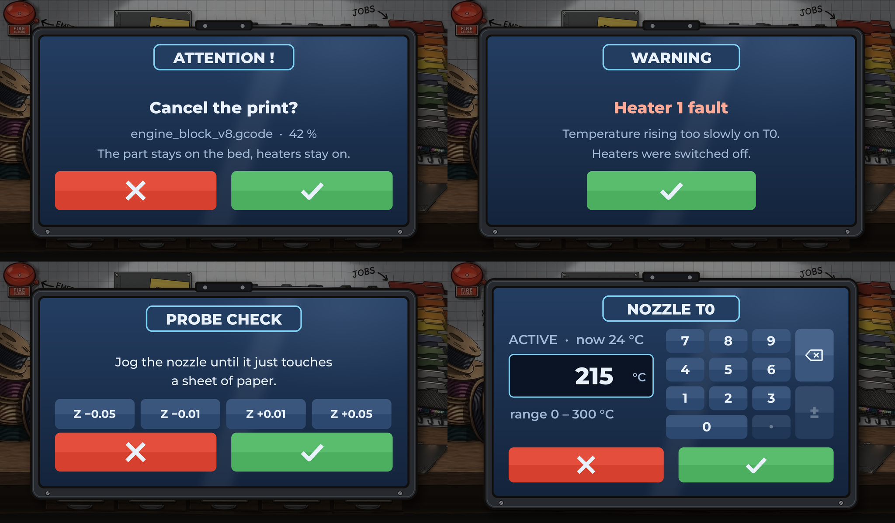
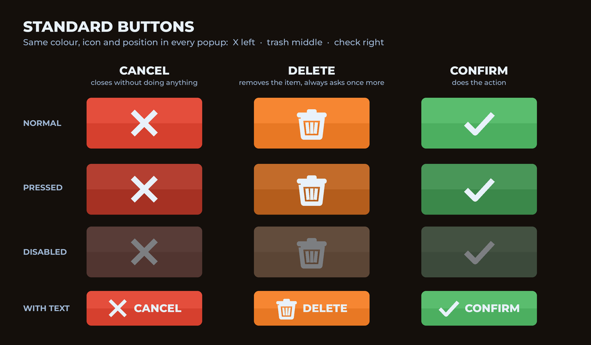
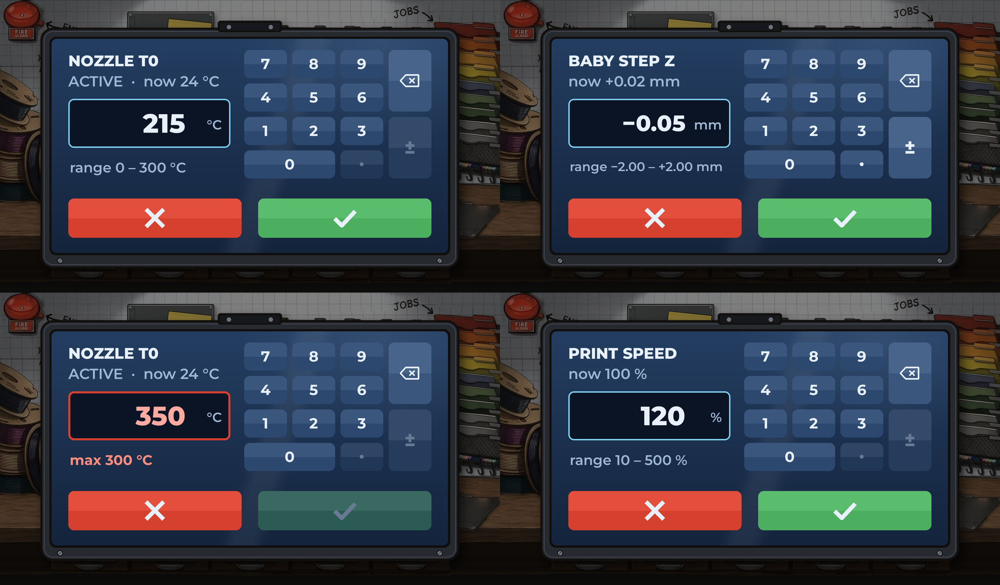
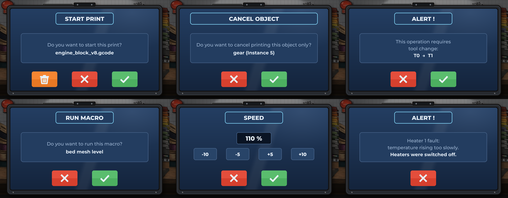
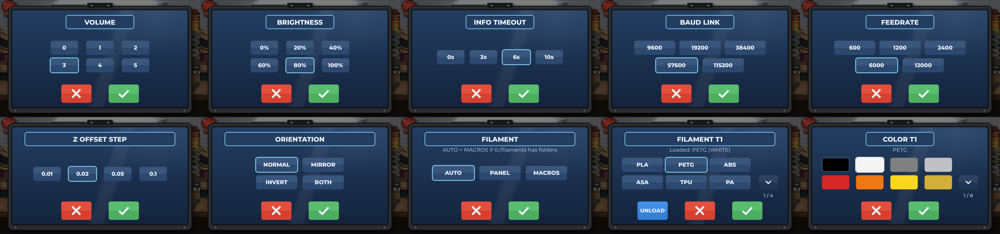

# Popup standard (locked)

Every popup in the Funky UI uses this frame, size and button set. Mock-ups are in
`docs/workshop/popups/`.

## Frame

The popup looks like the printer's own little screen, enlarged:

- dark bezel with ink outline, top bevel highlight, hinge bracket on top, two screws on the bottom lip
- blue glass (top-to-bottom gradient) with soft glare and one diagonal shine
- drop shadow onto the scene; the scene behind is dimmed (no blur)
- inside: title top-left, small context tag top-right (tool, page, `M291` …), thin divider, content, buttons along the bottom

**Standard size:** the mock-ups at 1.43× the first draft. A popup fills most of the
1024 × 600 screen (about 880–970 px wide, 470–570 px tall depending on content).

Implementation: frame as a 9-slice image, glass as an LVGL vertical gradient plus a
small glare sprite, buttons as styles or small images. Drawn once on open; only
changed areas redraw. No zoom/scale animations, no blur.

## Rule: Modern UI popups, new clothes

Every popup is taken from the PanelDue **Modern UI** firmware with the same layout,
title, text and buttons, and only re-dressed in this style. Exceptions with their own
new layout: the **numpad** (below) and the **keyboard** (to be designed).

## Name tile

The popup title (ATTENTION !, WARNING, the Modern UI tile names …) sits in a tile
centred at the top: outline only, filled with the popup's own glass colour so it
blends in. Text below it is centred.

The outline follows the tone of the message: **red** for errors, **amber** for warnings,
**blue** for everything else (info, settings, questions).

In code: `UI::Funky::Popup` (`src/UI/Widgets/Laptop/FunkyPopup.h`) — `choose()` (preset
tiles), `chooseRows()` (rows with captions, e.g. SOUND), `confirm()` (info card, X / ✓)
and `message()` (ERROR / WARNING / INFO with the whole text, X only).

## Standard buttons — icons only, no text

| Button | Icon | Colour | Position | Does |
|---|---|---|---|---|
| Delete | trash bin | orange/amber | left | removes the item, asks once more |
| Cancel | X | red | middle (centre when alone) | closes without doing anything |
| Confirm | check mark | green | right | does the action |

- Order follows Modern UI: trash (or an extra like UNLOAD) · X · check. Two buttons: X left, check right,
  centred as a pair. A lone X is centred.
- States: normal, pressed (darker, nudged down), disabled (greyed out, not hidden).
- Disabled when the action is impossible: check on an invalid/empty value or no
  selection or printer offline; trash on the file being printed or protected/read-only
  files. Cancel is practically never disabled.
- Icons: thick strokes, slightly smaller than the button height allows.
- Only firmware choice buttons (M291 with named options) show text.
- Extra buttons such as blue UNLOAD sit next to them where needed.

## Numpad popup (locked layout)

- **Name tile** on top (e.g. `NOZZLE T0`).
- **Left column:** status line (`ACTIVE · now 24 °C`), big value
  field with unit, range line (`range 0 – 300 °C`). Status and range text are large;
  a long range shrinks just enough to fit the column.
- **Right:** keypad `7 8 9 / 4 5 6 / 1 2 3 / 0 (double width) .`, plus a function column
  with **backspace (2 rows high)** above **± (2 rows high)**. No `C` key.
- **Bottom:** X (left) and check (right), icons only.
- First key press replaces the old value; holding backspace clears everything.
- `.` and `±` are greyed out where the field does not allow decimals / negatives
  (temperatures, speed %); enabled for offsets, baby-stepping etc.
- Out of range: value field and range text turn red (`max 300 °C`), check is disabled
  until the value is valid.

## Modern UI popups in the new style

Taken from `PanelDueFirmware-MODERN_UI` (`CreateModernStandardPopup`, 660 × 460): same
name tile (short/long), info card, choice buttons, positions and preset values,
mapped onto our frame. **Locked.**

Inner tiles (info card, choice and adjust buttons, page arrows) are only slightly
visible: a fill just lighter than the glass and a faint blue-grey outline. The
selected choice gets the bright blue outline. Coloured fills are reserved for the
action buttons (trash/UNLOAD, X, check).

